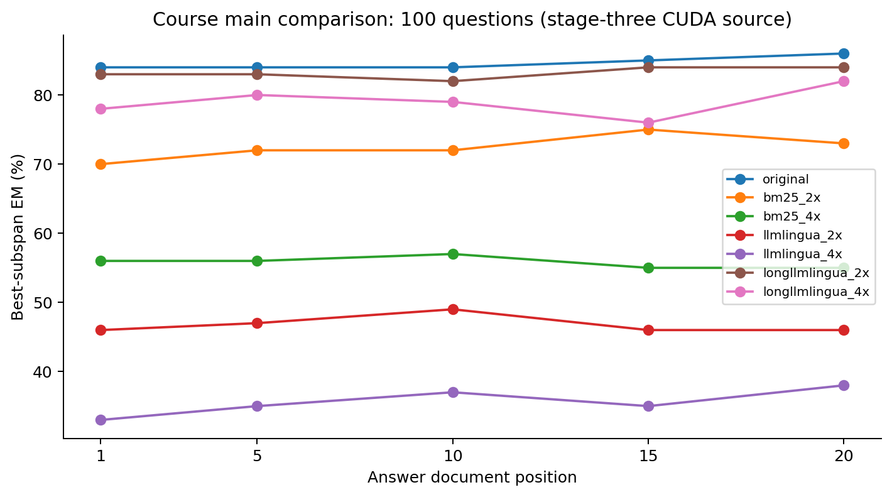
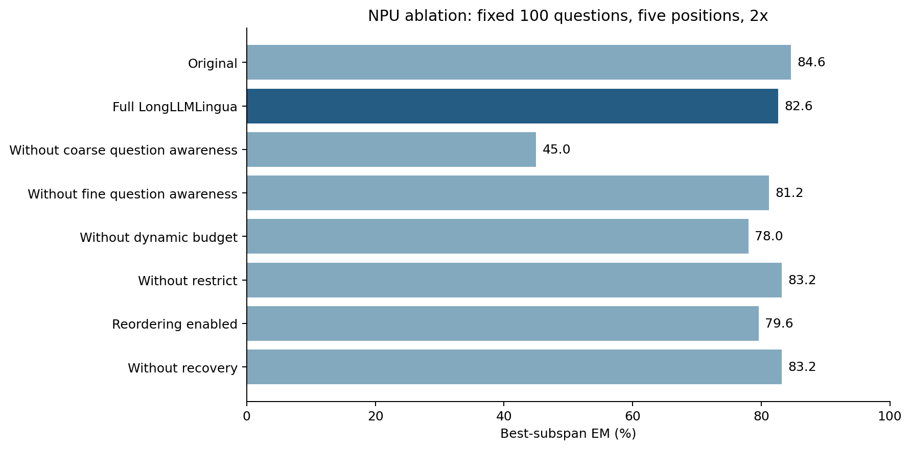
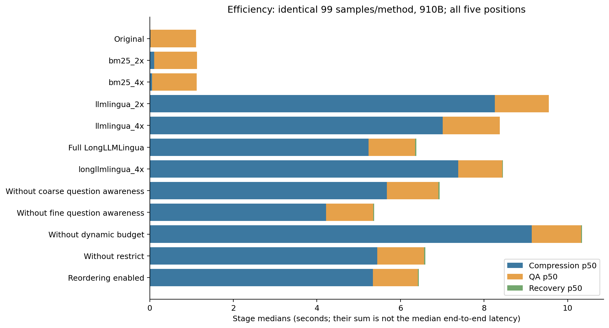

# LongLLMLingua 长上下文提示压缩复现

本项目复现论文 [LongLLMLingua: Accelerating and Enhancing LLMs in Long Context Scenarios via Prompt Compression](https://arxiv.org/abs/2310.06839v2) 中的问题感知提示压缩方法，在 NaturalQuestions 20 文档问答上比较回答质量、答案位置敏感性与压缩开销。

四个阶段的数据与基线、压缩适配、主比较、消融与效率实验现已整合为一套工程。**固定 100 题主比较与消融、独立效率矩阵均已完成并通过离线核验；阶段四待 PR 复核。** 本项目使用 DeepSeek 问答 API 替代论文的历史 GPT 模型，属于方法级复现，不声称复现论文绝对数值。

## 实验设计与完成情况

- 数据：每题 20 篇文档，答案文档位于第 1、5、10、15、20 位；五位置按稳定问题 ID 对齐。
- 比较方法：原始提示、BM25、LLMLingua、LongLLMLingua；压缩方法分别采用 2x/4x 完整提示预算，主比较关闭文档重排序。
- 压缩模型：LLaMA-2-7B-Chat；问答配置为 `deepseek-flash`、非思考、temperature=0、最大输出 512 token。
- 指标：固定上游的首行 `best_subspan_em`；实际压缩比为原始完整提示 token 数除以压缩后完整提示 token 数。
- 抽样：seed=42，20/100/500 题清单嵌套且固定。考虑课程预算，主比较与消融采用已经固定的 **pilot 100 题**；保留 `split=pilot` 标签，500 题清单仅用于扩展。

| 阶段 | 负责内容 | 已有证据 | 结果入口 |
| --- | --- | --- | --- |
| 成员一 | 数据、模板、API 缓存、评分、原始提示与 BM25 | smoke 20 题五位置，300/300 槽成功 | [阶段一验收](reports/stage1-acceptance/REPORT.md) |
| 成员二 | LLMLingua/LongLLMLingua 适配、机制开关与恢复 | smoke 20 题五位置，400/400 槽成功，保留 4 条预算超标 | [阶段二验收](reports/stage2-smoke/REPORT.md)、[参数映射](docs/stage2-parameter-map.md) |
| 成员三 | 批量调度、断点续跑、主比较与配对统计 | pilot 100 题五位置七组合，3500/3500 槽成功 | [主比较结果](reports/stage3-main/summary.json)、[覆盖率](reports/stage3-main/coverage.json) |
| 成员四 | 910B 执行、单机制消融、重排序、恢复及效率分析 | 消融 3500/3500、独立效率 1200/1200 槽成功 | [消融结果](reports/stage4-ablation-efficiency/RESULTS.md)、[效率表](reports/stage4-ablation-efficiency/efficiency.csv) |

这里的槽位是“问题 × 位置 × 方法”记录数，不等于独立问题数或新增 API 调用数。恢复消融复用同一原始回答，不重复调用 API。

## 主比较结果

以下是成员三在 CUDA 环境得到的固定 100 题结果，每种组合各 500 个问题位置样本。

| 方法 | 平均 EM（%） | 平均实际压缩比 |
| --- | ---: | ---: |
| 原始提示 | 84.6 | 1.00x |
| BM25 2x | 72.4 | 2.00x |
| BM25 4x | 55.8 | 4.01x |
| LLMLingua 2x | 46.8 | 2.04x |
| LLMLingua 4x | 35.6 | 4.17x |
| LongLLMLingua 2x | 83.2 | 2.08x |
| LongLLMLingua 4x | 79.0 | 4.09x |

LongLLMLingua 在本组设置下优于相同比值的两种压缩基线，准确率仍低于原始提示。2x 相对原始提示的差值为 -1.4 个百分点，问题级配对 bootstrap 95% 区间为 [-6.2, 3.0]。LongLLMLingua 4x 有 18/500 条未达到硬预算，原记录与实际比值均保留，不能将其视为严格等预算比较。完整配对统计见 [stats.json](reports/stage3-main/stats.json)。



## 消融与效率

成员四在 Ascend 910B4 上对相同 100 题运行完整 LongLLMLingua 2x 同机参照与五个变体，并离线移除恢复。完整方法 EM 为 **82.6%**；移除粗粒度问题感知后为 **45.0%**，移除动态预算后为 **78.0%**。细粒度、restrict、重排序的差值区间均跨 0；移除恢复为 83.2%，保留恢复产生的负面案例。



效率采用同机独立 smoke 20 题五位置、12 组合，1200 条均为成功且未命中本地问答/压缩缓存的测量。模型加载和两次压缩预热在逐槽计时之前；另统一剔除每方法首个样本，最终每方法使用相同的 **99 个问题位置样本**，报告 p50/p95 与峰值 HBM。

完整 LongLLMLingua 2x 的端到端 p50/p95 约为 **6.45/7.49 秒**，原始提示为 **1.12/1.54 秒**，完整方法的 allocated HBM 峰值约为 16.43 GB。压缩减少输入 token，但在本次服务与负载下未带来端到端延迟优势。API 网络与服务端缓存会影响测量，阶段中位数之和也不等于端到端中位数。



CUDA 主比较与 NPU 消融分开保留来源，不拼接不同硬件的耗时；旧 HTTP 402 中断效率运行未进入最终表。运行来源、环境、验证口径和限制见 [实验说明](docs/experiments.md)。

## 本地重建结果

只重建已保存的统计和图不需要模型权重、API 密钥或云服务器。使用 Python 3.12，在仓库根目录执行：

```bash
python -m venv .venv
```

激活环境：Windows PowerShell 使用 `.\.venv\Scripts\Activate.ps1`；Linux 使用 `source .venv/bin/activate`。然后执行：

```bash
python -m pip install -r requirements.txt
python scripts/analyze_stage4.py
python -m pip install matplotlib==3.10.0
python scripts/plot_results.py
python -m pytest tests/test_stage4_results.py tests/test_cloud910b.py tests/test_stage3.py tests/test_stage4_recovery_analysis.py tests/test_final_delivery.py
```

这 31 项检查覆盖调度、恢复分析、相同负载匹配和最终结果重建。完整 `python -m pytest` 还包含需要真实 NQ 文件及固定 tokenizer 的前阶段测试，应先执行 `python -m reproduction prepare` 获取公开数据；该命令不下载大模型、不调用问答 API。

`reports/stage4-ablation-efficiency/inputs/metrics.jsonl` 是用于重建统计的轻量逐槽指标，不包含完整提示、回答或请求缓存。完整数据、预测和原始返回包留在组内存储；取得原始包后可按 [实验说明](docs/experiments.md) 独立重评分。

## 工程结构与运行入口

```text
reproduction/     数据、基线、压缩适配、API、评分、恢复和批量调度
configs/          各阶段配置与云端实际运行配置
manifests/        固定来源、校验信息及嵌套样本 ID 清单
scripts/          验收、离线核验、云端执行、统计和绘图
tests/            数据隔离、预算、缓存、调度和统计检查
reports/          阶段一至四的轻量结果、图表、环境和核验记录
docs/             实现接口、论文参数映射与实验说明
vendor/           固定上游参考、模板、评分函数和许可证
```

阶段一基线入口为 `python -m reproduction`，压缩验证入口为 `python -m reproduction.stage2`，批量实验入口为 `python -m reproduction.stage3`，910B 包装入口为 `python scripts/cloud910b.py`。接口分别见 [基础实现](docs/stage1-implementation.md)、[压缩实现](docs/stage2-implementation.md) 和 [实验说明](docs/experiments.md)。

云端真实推理须使用已有匹配的 torch/torch_npu 环境，补充依赖采用 `requirements-cloud.txt`，其中 tokenizers=0.21.4 与 transformers=4.53.1 兼容；不要叠加安装基础环境中 tokenizers=0.22.1 的固定版本。配置中的模型路径由实际权重位置确定，密钥通过环境变量或 `.env` 提供，变量名见 `.env.example`。查看和重建现有结果无需重新运行真实实验。

## 来源与复现边界

- 核心压缩算法复用 [微软 LLMLingua](https://github.com/microsoft/LLMLingua) 的固定提交 `5a4c78ae18ab17a98cf997e8259354e546081d64`。本组贡献为工程适配、机制配置、实验执行、评估与分析，不声称原创压缩算法；不混用 LLMLingua、LongLLMLingua 与 LLMLingua-2。
- 数据构造、模板与 `best_subspan_em` 来源于 [Lost in the Middle](https://github.com/nelson-liu/lost-in-the-middle)，固定版本及校验信息见 `manifests/resources.json`。
- 历史 k=2 近似映射在当前 LongLLMLingua 路径中无效；论文的指令/问题预压缩未实现，恢复使用固定 DeepSeek tokenizer。具体差异见参数映射表。
- 模型权重、完整原始/处理数据、完整预测缓存、凭证、虚拟环境及大型日志不提交。上游版权和许可证保留在 `vendor/`。
