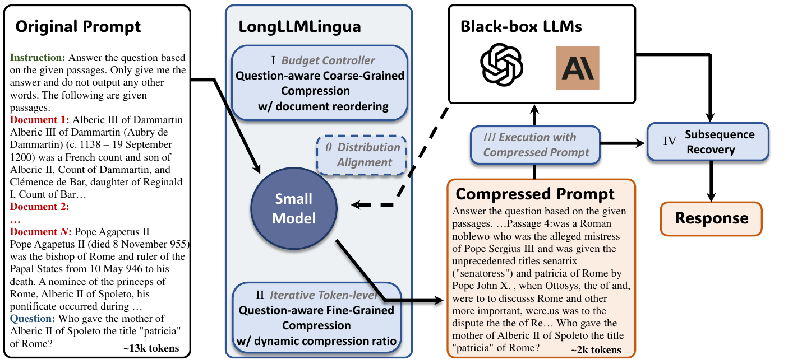
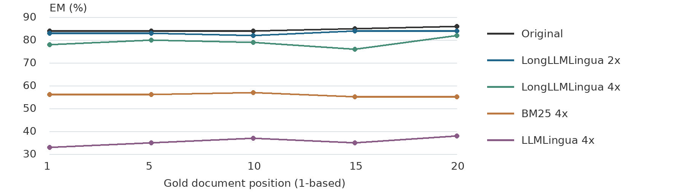

# LongLLMLingua 方法级复现报告

BIT 自然语言处理课程　G14
2026年11月21日（Asia/Shanghai）

摘要　针对长上下文问答中的冗余与位置偏置，本文整理并核验 G14 已有的 LongLLMLingua 复现记录。CUDA pilot 100题上，2×压缩 EM 为83.2%，原始提示为84.6%；按题配对的差值95%区间为[−6.2, +3.0]个百分点。独立NPU实验表明问题感知文档筛选作用较大，但本批次未获得端到端加速。本文仅作既有实验汇编与离线核验，不声称重新推理。

## 1　问题与复现范围

LongLLMLingua[1]通过提高与问题相关的信息密度、调整信息位置并恢复输出子序列，缓解长提示的成本与性能问题。本文检验三个问题：同一问答设置下能否在2×/4×压缩后保留准确率；哪些模块贡献较大；输入缩短是否转化为整条流水线加速。

范围限定为 Natural Questions 的20文档多文档问答版本[2,3]与固定 pilot 100题、五个gold位置；不覆盖原论文全部基准、训练或GPT-3.5绝对分数。问答模型替换为deepseek-flash，因此属于方法级而非逐数值复现。500题仅有清单，不作为已完成结果。

## 2　方法与实现差异

图1　LongLLMLingua原方法框架。来源：Jiang等[1]，arXiv:2310.06839v2，图2（原图截取，非本组实验图）。

粗粒度阶段以文档条件下的问题及restrict后缀的困惑度刻画相关性；细粒度阶段利用问题感知对比困惑度迭代选择token，并按文档排名动态分配预算。压缩后的提示送入黑盒问答模型，恢复模块在问答后对输出作子序列恢复[1,4]。

主比较关闭文档重排序，以保留五位置干预；重排序另列消融。固定实现中的k=2映射在当前路径无效，τ_ins=0.85与τ_que=0.9预压缩未实现；动态比率0.3按排名线性分配，不能宣称与论文控制完全等价[5]。

<!-- PAGE BREAK -->

## 3　数据、实现设置与公平性

### 3.1　输入与版本固定

数据总体为2655题。先按稳定ID排序，再用seed=42打乱，按嵌套前缀取得smoke 20题、pilot 100题和main 500题。每题20篇文档，gold置于1、5、10、15、20（从1计数）。一“槽”指题目×位置×方法，不是独立问题。输入仅含问题与文档ID、标题、正文；参考答案、gold标记和位置元数据不进入BM25或问答提示[6]。

| 项目 | 实际设置与来源 |
| --- | --- |
| 压缩器 | LLMLingua与LongLLMLingua共用LLaMA-2-7B-Chat镜像权重；fp16、eager，迭代段长200 |
| 问答API | deepseek-flash，非思考，temperature=0，max_tokens=512；历史真实记录保持不变 |
| 计数与BM25 | DeepSeek固定分词器；BM25 k1=1.5、b=0.75，unicode-word-lower-v1 |
| 代码锁定 | 压缩库、数据模板与指标锁定提交；完整SHA见[9,10]，权重revision见附录A |
| 实际批次 | 阶段三为CUDA（仅cuda:0，型号未登记）；阶段四为Ascend910B4，不能合并硬件记录 |

### 3.2　指标、配对区间与预算边界

主指标沿用首行best_subspan_em：先取模型回答第一行，再按上游规范化规则检查参考答案子串。它不是语义正确性判定，否定句提及答案也可能得1分。统计先在每题内平均五位置，再计算方法与original的题内差值；以题目为单位配对bootstrap 2000次，seed=42，保留同题全部位置，报告95%区间[7]。不能把500槽当作500道独立题。

所有方法共享题单、可见输入、模板、问答设置与计数口径。硬预算目标为⌊原始完整提示本地token数/目标倍率⌋；压缩器最多3轮收紧预算，保留超标槽而不删失。库内context_budget=“+100”是软余量，不是最终合格标准。恢复只作用于回答，且采用DeepSeek分词器，区别于论文恢复粒度[5]。

本地预算仅计提示文本，不含API聊天封装；阶段一300槽的API输入均比本地多4 token，不能将文本长度直接当账单。压缩率均值是逐槽比值的平均，不等于API输入总量之比。temperature=0和返回fingerprint亦不足以证明不可变模型快照。

### 3.3　分阶段验收与证据等级

| 批次 | 槽数与结果 | 解释 |
| --- | --- | --- |
| 阶段一 smoke | 20×5×3=300；EM 92.0/87.0/64.0% | 依次为original/BM25 2×/4×；预算300/300 |
| 阶段二 smoke | 20×5×4=400；预算396/400 | canonical run a1bd…；4槽超标，不写成全合格 |
| 离线审计 | 阶段一重评分不一致0；API 0 | 既有审计记录耗时2.055秒，不是推理效率 |

阶段一已记录五个公开gz校验和一致、20题跨位置文档集合与gold位置检查失败0。阶段二4个异常均为同题Long 4×，目标742，实测749/751/754/753 token；只报告现象，不推断完整缓存中尚未核实的根因。兼容旧分支stage_3的394/400不作为本报告口径。

<!-- PAGE BREAK -->

## 4　主比较：CUDA pilot 100题

阶段三run e8f151b9c286648caf98共3500/3500槽：100题×5位置×7方法，每方法500槽。表1来自summary.json与stats.json[7]；置信区间直接引用既有按题配对统计，不以汇总均值伪造逐样本区间。下文Long为LongLLMLingua的简称。

表1　CUDA主比较。EM为%；Δ与95% CI为相对original的百分点（pp）；倍率为本地实测均值。

| 方法 | EM | Δ (pp) | 95% CI (pp) | 倍率 | 预算合格 |
| --- | --- | --- | --- | --- | --- |
| Original | 84.6 | — | 基线 | 1.000× | 500/500 |
| BM25 2× | 72.4 | -12.2 | [-19.2, -5.8] | 2.002× | 500/500 |
| BM25 4× | 55.8 | -28.8 | [-37.6, -19.4] | 4.006× | 500/500 |
| LLMLingua 2× | 46.8 | -37.8 | [-46.8, -29.2] | 2.044× | 500/500 |
| LLMLingua 4× | 35.6 | -49.0 | [-57.6, -40.0] | 4.173× | 500/500 |
| Long 2× | 83.2 | -1.4 | [-6.2, +3.0] | 2.080× | 500/500 |
| Long 4× | 79.0 | -5.6 | [-11.6, -0.4] | 4.090× | 482/500 |

同批次中，Long 2×较BM25 2×高10.8pp，Long 4×较BM25 4×高23.2pp；这是点估计差，表1区间的参照始终是original，不能误用作方法间差值的区间。LLMLingua在本设置明显较低，不能据此断言其在所有任务无效。

Long 2×相对original为−1.4pp，95% CI [−6.2, +3.0]跨0：数据未明确区分两者，但未预设等效界值，不能写成“等效”或“无损”。Long 4×差−5.6pp，区间[−11.6, −0.4]，且18/500槽超预算；79.0%的EM是含这些超标槽的整体结果，不是严格4×预算下的无条件性能。

图2　同一CUDA批次的分位置EM，每点100题。依据[7]的groups重绘；坐标从30%起，未绘方法见表1。

图2将平均分拆至五个位置，避免只凭总体EM判断位置鲁棒性。当前原始提示未呈现典型的“中间最差”曲线；本文未另作位置差的显著性检验，不将其包装为复现了论文全部位置偏置现象。Long两档在所测位置均相对稳定，但只有100题与五个离散位置，不能推出一般长上下文鲁棒性。

阶段一original 92.0%对应嵌套smoke 20题，阶段三84.6%对应pilot 100题及独立运行；两者不是同一分母。本文不跨批次拼接最优值，也不将小样本smoke结果作为CUDA主比较的基线。

<!-- PAGE BREAK -->

## 5　独立NPU消融与效率

### 5.1　单因素消融

阶段四run a9d2295195adde90484d基于pilot 100题、五位置，既有推理记录3500槽。参照是同机Long 2×的82.6%，不是CUDA的83.2%。表2中“无恢复”由已有恢复前得分离线派生，不额外计作500次推理[8]。

表2　NPU消融，各行500槽；Δ与按题配对95% CI均相对同批次完整Long 2×。

| 方法/改动 | EM (%) | Δ (pp) | 95% CI (pp) |
| --- | --- | --- | --- |
| Original | 84.6 | +2.0 | [-2.2, +7.0] |
| Long 2×完整 | 82.6 | +0.0 | 参照 |
| 无问题感知粗粒度 | 45.0 | -37.6 | [-47.2, -28.4] |
| 无问题感知细粒度 | 81.2 | -1.4 | [-4.2, +1.2] |
| 无动态预算 | 78.0 | -4.6 | [-8.6, -0.8] |
| 无restrict后缀 | 83.2 | +0.6 | [-2.2, +3.6] |
| 额外开启重排序 | 79.6 | -3.0 | [-7.2, +0.8] |
| 无恢复（离线派生） | 83.2 | +0.6 | [+0.0, +1.6] |

“无粗粒度”具体是将rank_method改为llmlingua，仍保留文档过滤，并非禁用整个筛选过程；其−37.6pp支持问题感知排序在本设置的重要性。去动态预算下降4.6pp。细粒度与restrict的区间跨0，证据不足以稳定排序小幅效果；主比较原本关闭重排序，此处为额外打开而非再次移除。

关闭恢复的点估计反而高0.6pp，区间[0.0, +1.6]包含边界0；已有3条恢复由对变错记录，集中于2题。恢复不是单调有益模块，不能以原论文叙述替代本批次负面证据。

### 5.2　端到端效率而非仅token节约

效率独立run 2a7f4accf6127178a76b共1200槽（12方法×100个共同题目—位置槽）。每方法去掉同一个首槽后为99槽，位置分布19/20/20/20/20；它们不是99道独立题。表3保留主要参照，完整12行见随附CSV。

表3　NPU同批次耗时（秒）与峰值分配内存（十进制GB）；p50/p95分别为中位数/95分位。

| 方法 | 压缩p50 | API p50 | 端到端p50 / p95 | 峰值GB |
| --- | --- | --- | --- | --- |
| Original | 0.01 | 1.09 | 1.12 / 1.54 | 未报 |
| BM25 2× | 0.10 | 1.03 | 1.20 / 1.59 | 未报 |
| LLMLingua 2× | 8.26 | 1.30 | 9.63 / 12.45 | 16.25 |
| Long 2× | 5.23 | 1.12 | 6.45 / 7.49 | 16.43 |
| Long 4× | 7.38 | 1.05 | 8.57 / 12.88 | 14.99 |

端到端包含压缩、API与恢复及流程开销。Long 2×为6.45秒，对比original 1.12秒，没有端到端加速；压缩开销在本批次占主导。各组件分位数不能直接相加得到总分位数。效率不等于API账单，也不包含Cursor会话计时；CUDA与NPU耗时不可相加。

<!-- PAGE BREAK -->

## 6　真实案例与误差边界

附录B给出S1-01至S1-13共13条真实槽索引、参考答案、首行原文、token与分数；全部来自阶段一run d54b3118c61ea4930624，且本轮逐条与canonical predictions.jsonl核对一致。它们只覆盖4道题，不是13道独立问题，更不是阶段三LongLLMLingua的逐样本误差集。

| 真实槽索引 | 观察 | 可支持的解释 |
| --- | --- | --- |
| S1-01—03 | Manipur：original/2×对，4×错；822/822 token | 输出Pakhangpa而非参考Pakhangba/Pamheiba；预算合格不保证答案保留 |
| S1-04—06 | Macbeth：三种方法均写Banquo，均得1 | BM25在部分问题可保留关键实体，不应只挑失败槽 |
| S1-07—11 | Heaven：拒答、否定提及和首行边界 | S1-08/09否定句含Los Lonely Boys仍得1；10/11仅后续行命中 |
| S1-12—13 | Astros：2013变为2017；4×得0 | 压缩后发生年份混淆；仅由输出不能断定内部因果 |

词面与语义不一致是关键评价边界。S1-08/09明确否认文档提供目标歌名，却因首行带出Los Lonely Boys得1。阶段一既有离线审计共标出4槽同类现象；另2槽original若把全文换行拼接后评分会从0变1。本文保留官方首行分，不在看到结果后换指标，也不把该诊断当作校正后的主结果。

独立恢复负例中，Bantu Education Act回答在恢复后截短而由1变0；Cracker Barrel的两个位置输出被替换为“645 stores in 44 states”等文本后得0。已有文件支持“恢复可能损害既定EM”这一观察，但缺完整缓存与参考答案上下文，不能进一步声称已定位全部语义根因[8]。

## 7　局限、代码与AI辅助披露

外部有效性受限于单一数据集、100题、五位置及问答模型替代。硬预算适配、恢复分词器与无效k映射均偏离论文；API版本标识不是不可变快照。未预注册等效界值，多个消融区间是探索性逐项区间，未作多重比较校正；小差异不作稳健优劣结论。

来源完整性仍有缺口：CUDA型号与阶段四CANN版本未登记；tokenizers 0.21.0/0.21.4属不同环境记录；阶段二16.67 GB与效率表16.428 GB不合并。阶段二/三/四完整results、压缩输出/问答缓存及其校验和未取得，不能独立重放全部推理；阶段一canonical预测已核验，不能将缺口泛化为阶段一预测缺失。

代码依赖上游LLMLingua与Lost in the Middle，使用锁定版本，未在本轮修改源代码或原结果。AI辅助用于材料汇编、中文写作、表图生成、来源对照与排版检查；不替代真实API回答，不生成压缩文本或补造案例。已有补充离线审计和43项离线测试通过属于代码/记录核验，不是新的3500槽推理；43项为仓库侧回传，本报告制作未重跑该测试集。

受控Cursor试跑未执行、无新分数，不把Cursor对话当DeepSeek API。代推进与排版也不是成员二至四的亲历运行；未替成员勾选自检。P编号、成员姓名、本人贡献确认和录屏待补，不作课程满分或整包验收通过声明。

## 8　结论

现有证据支持：在本次方法级设置中，LongLLMLingua较传统压缩基线保留更多问答性能，问题感知文档排序贡献突出；但2×未证成等效，4×有预算超标，且本批次不支持端到端加速。结论边界应与具体批次、计数口径和未取得的原始输出同时保留。

<!-- PAGE BREAK -->

## 参考文献与公开来源（不计正文）

正文为前5页。以下为参考文献及来源索引；公开网页核对日期：2026年11月21日（Asia/Shanghai）。文献作者以ACL Anthology正式条目核对，版权人不代替合著者名单。

[[1] Jiang, H., Wu, Q., Luo, X., Li, D., Lin, C.-Y., Yang, Y., & Qiu, L. 2024. LongLLMLingua: Accelerating and Enhancing LLMs in Long Context Scenarios via Prompt Compression. ACL 2024 (Long Papers). 本报告对照arXiv:2310.06839v2。 [点击来源]](https://aclanthology.org/2024.acl-long.91/)

[[2] Liu, N. F., Lin, K., Hewitt, J., Paranjape, A., Bevilacqua, M., Petroni, F., & Liang, P. 2024. Lost in the Middle: How Language Models Use Long Contexts. Transactions of the Association for Computational Linguistics, 12:157–173. [点击来源]](https://aclanthology.org/2024.tacl-1.9/)

[[3] Kwiatkowski, T., et al. 2019. Natural Questions: A Benchmark for Question Answering Research. Transactions of the Association for Computational Linguistics, 7:453–466. [点击来源]](https://aclanthology.org/Q19-1026/)

[[4] Jiang, H., Wu, Q., Lin, C.-Y., Yang, Y., & Qiu, L. 2023. LLMLingua: Compressing Prompts for Accelerated Inference of Large Language Models. EMNLP 2023. [点击来源]](https://aclanthology.org/2023.emnlp-main.825/)

[[5] G14. 论文参数与固定实现对照（stage2-parameter-map.md）；记录k映射、预压缩、计数和恢复的差异。 [点击来源]](https://github.com/SPikerinbit/longllmlingua-reproduction/blob/a64294fe86584395e87a33867261094ff4cbf596/docs/stage2-parameter-map.md)

[[6] G14. 阶段一离线审计、canonical预测与13槽案例；stage1-foundation公开记录。 [点击来源]](https://github.com/SPikerinbit/longllmlingua-reproduction/blob/fba1b896f889d30087280cbe57f8e5c0d161ac03/reports/stage1-supplement/cases.md)

[[7] G14. CUDA pilot主比较：run.json、summary.json与stats.json；stage3-main-comparison公开记录。 [点击来源]](https://github.com/SPikerinbit/longllmlingua-reproduction/blob/e07ac7726faa364e15b1ff6b2ab0299c0aa84883/reports/stage3-main/stats.json)

[[8] G14. 独立NPU消融、效率与恢复负例；stage4-ablation-efficiency公开记录。 [点击来源]](https://github.com/SPikerinbit/longllmlingua-reproduction/tree/f08b229b3b650ab7c82aa366ba83a895d87f5fe9/reports/stage4-ablation-efficiency)

[[9] Microsoft. LLMLingua公开实现，锁定提交5a4c78ae18ab17a98cf997e8259354e546081d64。 [点击来源]](https://github.com/microsoft/LLMLingua/tree/5a4c78ae18ab17a98cf997e8259354e546081d64)

[[10] Lost in the Middle. 数据、问答模板及评分代码，锁定提交29b8a6d042ce29abccee3db1a73171a107d7e6af。 [点击来源]](https://github.com/nelson-liu/lost-in-the-middle/tree/29b8a6d042ce29abccee3db1a73171a107d7e6af)

[[11] BIT自然语言处理课程. 2026年课程要求，第七节。验收由课程方判定，本文不推定评分。 [点击来源]](https://nlp.hltbit.top/2026/materials/w01/classroom/requirements.html)

本地随附SOURCES.md给出来源清单、对应批次、锁定分支头与文件SHA-256；sources/保存实际用于报告的轻量表格与案例。原论文PDF位于用户指定本地目录；图1标注原文图号。本文新绘图2仅从真实分位置汇总重绘，未添加模拟点。

<!-- PAGE BREAK -->

## 附录A　可追溯性与待补清单（不计正文）

### A.1　锁定资源与真实运行

压缩权重：NousResearch/Llama-2-7b-chat-hf；revision 351844e75ed0bcbbe3f10671b3c808d2b83894ee。DeepSeek计数分词器：deepseek-ai/DeepSeek-V4.1-Flash；revision 314113f8a7dadb388215396ba5fbee2c610a04d6。问答API模型名并不证明该版本被不可变固定。

阶段四已记录环境：Python 3.12.0，torch 2.7.1，torch-npu 2.7.1.post2，transformers 4.53.1，tokenizers 0.21.4，numpy 1.26.4，accelerate 1.0.1；设备Ascend910B4。CANN版本未登记，不能以npu-smi版本替代。

| 阶段 / run_id | 证据定位（仓库路径） |
| --- | --- |
| 一 d54b3118c61ea4930624 | reports/stage1-acceptance/predictions.jsonl；reports/stage1-supplement/offline-audit.json |
| 二 a1bd26fe3d82dea3f65d | reports/smoke-stage2-acceptance.json；预算396/400 |
| 三 e8f151b9c286648caf98 | reports/stage3-main/run.json、summary.json、stats.json |
| 四 a9d2295195adde90484d | reports/stage4-ablation-efficiency/ablation.csv与inputs/ablation-run.json |
| 效率 2a7f4accf6127178a76b | 同目录efficiency.csv与inputs/efficiency-run.json |

阶段三实际pilot配置只认reports/stage3-main/run.json中的config与题单；默认configs/stage3.json是main split，不作为本批次运行命令。可只读查看：python -m json.tool reports/stage3-main/run.json。阶段四若在具备仓库的环境离线重建，应使用python scripts/analyze_stage4.py --out /tmp/g14-stage4-audit，不能覆盖原结果；本报告制作未运行该命令。

阶段一canonical预测SHA-256：
cac37c9e84678f2f591af8c4f6ccdb7a69d010cf71eae5678b85109bcb27bd62。该校验和与已有审计一致。本轮另对13槽的首行与分数做逐条核对，并比对远端主比较统计和消融表，均一致；未重新调用模型。

### A.2　源稿差异处理记录

| 项目 | 本报告处理 |
| --- | --- |
| 旧稿“PDF未生成” | 此项随交付更新为已生成；不据此改写其他实验状态 |
| stage2旧394/400 | 推荐分支口径396/400；旧兼容副本单独说明，不混用run |
| PPT中的pilot配置入口 | 仓库不存在独立pilot-as-run配置文件；只引用真实run.json快照 |
| 离线测试数量 | 旧36项/31项是早期口径；按最新仓库侧回传43项，未冒称本报告制作亲跑 |
| 环境与显存差异 | 阶段二CANN 8.5.2不外推至阶段四；tokenizers与峰值GB并列差异不暗改 |
| 后续仓库变化 | 本地清单保存此次观测分支头；后续源更新需重新对照，不自动宣称一致 |

### A.3　实际剩余缺口

① CUDA具体型号、阶段四CANN与完整环境锁；② 阶段二/三/四逐条输出、完整提示/问答缓存及其校验和，进而补充Long方法级失败案例；③ P编号和成员姓名；④ 成员本人运行/贡献确认、自检、实际计时与录屏。报告本地PDF与可编辑源已交付，但这些事项均未代勾，亦未声称课程终包或评分全部通过。

<!-- PAGE BREAK -->

## 附录B　13条真实槽案例（1/4，不计正文）

统一run：d54b3118c61ea4930624；问答：deepseek-flash。以下为来源首行原文（保留英文以便核验），分数不重写。时间统一转换为Asia/Shanghai。完整64位ID与slot_id随附cases-verified.json，以下使用12位ID前缀定位，前缀在本组13槽中无歧义。

### S1-01　original / 位置1

问题：who was the first coronated king of manipur at kangla
参考：Pakhangba；Pamheiba　｜　ID前缀：ef848352f36b

score=1；原始/压缩/目标=3289/3289/3289 token；2026-11-06 18:10:59（Asia/Shanghai）

Based on the provided search results, the first coronated king of Manipur at Kangla was **Pakhangba**, who ascended the throne in 33 AD according to the royal chronicle "Cheitharol Kummaba" [Document 1]. The search results also mention that "Kanglei which is now called 'Kangla' was the first capital" and that Pakhangpa gave birth to the seven clans of Meitei society [Document 2].

诊断：无诊断标记。

### S1-02　bm25_2x / 位置1

问题：who was the first coronated king of manipur at kangla
参考：Pakhangba；Pamheiba　｜　ID前缀：ef848352f36b

score=1；原始/压缩/目标=3289/1644/1644 token；2026-11-06 18:11:00（Asia/Shanghai）

Based on the provided search results, the first coronated king of Manipur at Kangla was **Pakhangba**. According to Document [1], "'Kangla' was the royal palace since the reign of Pakhangba who ascended the throne in 33 AD, according to 'Cheitharol Kummaba', the royal Chronicle of Manipur." Document [2] also states that "Kanglei which is now called 'Kangla' was the first capital" and references the reign of "Konchin Tukthapa Ipu Athoupa Pakhangpa."

诊断：无诊断标记。

### S1-03　bm25_4x / 位置1

问题：who was the first coronated king of manipur at kangla
参考：Pakhangba；Pamheiba　｜　ID前缀：ef848352f36b

score=0；原始/压缩/目标=3289/822/822 token；2026-11-06 18:11:02（Asia/Shanghai）

Based on the provided search results, the specific name of the first coronated king of Manipur at Kangla is not explicitly stated. However, Document [1] mentions that "Kanglei which is now called 'Kangla' was the first capital" and that mythological origins begin with the reign of "Konchin Tukthapa Ipu Athoupa Pakhangpa," who gave birth to the seven clans of Meitei society.

诊断：无诊断标记。

<!-- PAGE BREAK -->

## 附录B　13条真实槽案例（2/4，不计正文）

### S1-04　original / 位置1

问题：character in macbeth who is murdered and appears as a ghost
参考：Lord Banquo；Banquo　｜　ID前缀：0b6dde118f5c

score=1；原始/压缩/目标=2898/2898/2898 token；2026-11-06 18:11:37（Asia/Shanghai）

The character in Macbeth who is murdered and appears as a ghost is Banquo. According to the search results, Banquo is at first an ally to Macbeth, and the witches prophesy that Banquo will not be king himself but that his descendants will be. Later, Macbeth sees Banquo as a threat and has him murdered by two hired assassins, though Banquo's son Fleance escapes. Banquo's ghost returns in a later scene (the Banquet Scene), causing Macbeth to react with alarm during a public feast.

诊断：无诊断标记。

### S1-05　bm25_2x / 位置1

问题：character in macbeth who is murdered and appears as a ghost
参考：Lord Banquo；Banquo　｜　ID前缀：0b6dde118f5c

score=1；原始/压缩/目标=2898/1449/1449 token；2026-11-06 18:11:39（Asia/Shanghai）

Based on the search results, the character in Macbeth who is murdered and appears as a ghost is **Banquo**. Document [1] states that Macbeth "has him murdered by two hired assassins" and that "Banquo's ghost returns in a later scene [Banquet Scene], causing Macbeth to react with alarm during a public feast." Document [4] also describes the ghost of Banco (Banquo) sitting in Macbeth's place at the table and Macbeth raving at the ghost.

诊断：无诊断标记。

### S1-06　bm25_4x / 位置1

问题：character in macbeth who is murdered and appears as a ghost
参考：Lord Banquo；Banquo　｜　ID前缀：0b6dde118f5c

score=1；原始/压缩/目标=2898/724/724 token；2026-11-06 18:11:40（Asia/Shanghai）

Based on the search results, the character in Macbeth who is murdered and later appears as a ghost is **Banquo**. According to Document [1], Macbeth sees Banquo as a threat and has him murdered by two hired assassins, and "Banquo's ghost returns in a later scene [Banquet Scene], causing Macbeth to react with alarm during a public feast."

诊断：无诊断标记。

<!-- PAGE BREAK -->

## 附录B　13条真实槽案例（3/4，不计正文）

### S1-07　original / 位置10

问题：who sang the song how far is heaven
参考：Los Lonely Boys　｜　ID前缀：64a3debb5e07

score=0；原始/压缩/目标=2928/2928/2928 token；2026-11-06 18:13:56（Asia/Shanghai）

Based on the provided search results, I cannot definitively answer who sang a song titled "How Far Is Heaven." None of the documents mention a song with that exact title.

诊断：无诊断标记。

### S1-08　bm25_2x / 位置10

问题：who sang the song how far is heaven
参考：Los Lonely Boys　｜　ID前缀：64a3debb5e07

score=1；原始/压缩/目标=2928/1463/1464 token；2026-11-06 18:13:58（Asia/Shanghai）

Based on the provided search results, none of the documents contain information about a song titled "How Far Is Heaven." The results discuss songs such as "If Heaven Wasn't So Far Away" (recorded by Rhett Akins and later Justin Moore), "Heaven" (by Los Lonely Boys and by Warrant), "The Nearest Thing to Heaven" (by Bunny Walters), "Far from Heaven" (a film), and "Little Bit of Heaven" (by Lisa Stansfield), but none mention "How Far Is Heaven" or identify who sang it.

诊断：首行有明确否认，但官方分数为 1。

### S1-09　bm25_4x / 位置10

问题：who sang the song how far is heaven
参考：Los Lonely Boys　｜　ID前缀：64a3debb5e07

score=1；原始/压缩/目标=2928/732/732 token；2026-11-06 18:13:59（Asia/Shanghai）

Based on the provided search results, none of the documents contain information about a song titled "How Far Is Heaven." The results mention songs such as "If Heaven Wasn't So Far Away," "Heaven" by Los Lonely Boys, "The Nearest Thing to Heaven," and "Over the Hills and Far Away," but none of these match the song in your question. Therefore, the search results do not provide an answer.

诊断：首行有明确否认，但官方分数为 1。

### S1-10　original / 位置5

问题：who sang the song how far is heaven
参考：Los Lonely Boys　｜　ID前缀：64a3debb5e07

score=0；原始/压缩/目标=2928/2928/2928 token；2026-11-06 18:13:03（Asia/Shanghai）

Based on the provided search results, there is no song titled "How Far Is Heaven." However, the search results do contain information about several songs with "Heaven" in the title, including:

诊断：参考答案不在首行、拼成一行后才会被同一评分函数记为 1。

<!-- PAGE BREAK -->

## 附录B　13条真实槽案例（4/4，不计正文）

### S1-11　original / 位置20

问题：who sang the song how far is heaven
参考：Los Lonely Boys　｜　ID前缀：64a3debb5e07

score=0；原始/压缩/目标=2928/2928/2928 token；2026-11-06 18:15:51（Asia/Shanghai）

Based on the search results, I cannot definitively answer who sang a song titled "How Far Is Heaven." The provided documents discuss several songs with "Heaven" in the title, but none is exactly "How Far Is Heaven."

诊断：参考答案不在首行、拼成一行后才会被同一评分函数记为 1。

### S1-12　original / 位置1

问题：when did the astros change from the national league to the american league
参考：2013；March 31, 2013　｜　ID前缀：eea8ae864c0e

score=1；原始/压缩/目标=2841/2841/2841 token；2026-11-06 18:12:37（Asia/Shanghai）

The Astros moved to the American League West division in 2013, after spending their first 51 seasons in the National League. It was announced that 2012 would be the last season for the Astros in the NL, and the move was a condition for the sale to the new ownership group.

诊断：无诊断标记。

### S1-13　bm25_4x / 位置1

问题：when did the astros change from the national league to the american league
参考：2013；March 31, 2013　｜　ID前缀：eea8ae864c0e

score=0；原始/压缩/目标=2841/708/710 token；2026-11-06 18:12:40（Asia/Shanghai）

The Astros moved to the American League after the 2017 American League Championship Series, where they defeated the Boston Red Sox 3–1 in the ALDS; this was the Astros' fifth appearance in a League Championship Series and their first since transferring from the National League to the American League.

诊断：无诊断标记。

可复查来源：reports/stage1-supplement/cases.md与canonical predictions.jsonl。本报告13条槽不代表13道独立问题，且不能替代尚缺的阶段二/三完整逐条记录。
